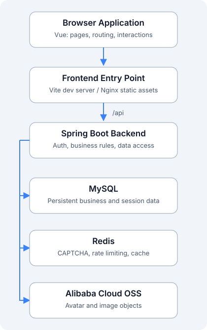
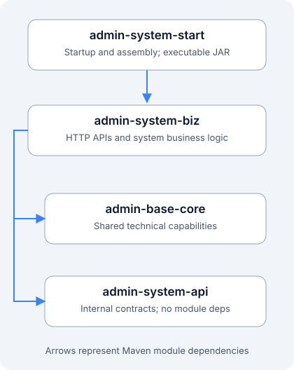

# System Architecture

Maple Hush Admin separates the frontend and backend and uses a modular monolith on the backend. The browser runs a Vue application and accesses Spring Boot through `/api`. MySQL, Redis, and OSS handle persistent data, temporary state, and object storage respectively.

## How the System Works Together



| Component | Responsibility |
| --- | --- |
| Browser application | Page rendering, form interactions, dynamic menus, permission-based display, and session coordination |
| Frontend entry point | Serves static assets and proxies same-origin /api requests to the backend; Vite provides the entry during source development, and frontend Nginx provides it in containers |
| Spring Boot | Input validation, authentication and authorization, business transactions, data access, auditing, and file handling |
| MySQL | Stores business entities, authorization relationships, refresh sessions, logs, and Flyway history |
| Redis | Stores CAPTCHAs, rate-limit counters, user snapshots, effective-permission caches, and similar state; does not hold primary business data |
| Alibaba Cloud OSS | Stores avatars and image objects; the backend validates and uploads them, and the frontend does not hold OSS AccessKeys |

Arrows show the main request or access directions, not container network topology or server installation steps. The documentation site is built independently as static pages; previewing it does not require these business services.

## Backend Module Dependencies



Arrows show Maven project module dependencies: `start → biz`, `biz → core`, and `biz → api`. Currently, `admin-system-api` has no project module dependencies, and `admin-base-core` does not depend on business modules.

| Module | Responsibility | Outside Its Responsibility |
| --- | --- | --- |
| admin-base-core | Common responses, exceptions, base entities, shared Redis/MyBatis configuration, JWT foundations, and OSS technical capabilities | Does not implement specific business features such as users or roles |
| admin-system-api | Internal Java contracts for the current user, permission checks, department queries, and similar capabilities | Is not an HTTP Controller or an independent API service |
| admin-system-biz | APIs and business implementations for authentication, users, roles, menus, departments, dictionaries, logs, and files | Is not packaged and started independently |
| admin-system-start | Application entry, environment assembly, Flyway, runtime documentation configuration, and integration tests | Does not collect business implementations in one place |

The four modules ultimately form **one executable Jar and one Spring Boot process**. Module boundaries control responsibilities and dependencies; they do not represent four microservices.

## A Business Request

1. A page calls a request method in the application's `src/api/`.
2. The request layer attaches an access token and handles the common response and any required session refresh.
3. Backend authentication filters identify the current user, and the API checks its required permission codes.
4. The Controller receives and validates a DTO, then calls a Service interface.
5. The Service implements business rules and transactions and accesses data through a Mapper.
6. The backend returns a common result; the frontend extracts the business data and updates the page.

```text
Page → API request layer → Authentication and authorization → Controller → Service interface / implementation → Mapper → MySQL
```

Ordinary business responses use `code`, `data`, `error`, and `message`, with `code=0` for success. Paginated business data uses `items` and `total`. HTTP status, business error codes, and display messages have different responsibilities; detailed API rules are covered in the development standards.

## Authentication and Authorization Responsibilities

| Capability | Implementation |
| --- | --- |
| Login | Username, password, and image CAPTCHA validation; initial accounts must first complete a mandatory password change |
| Ordinary API authentication | Authorization: Bearer access token; the backend issues and validates JWTs |
| Refresh and logout | An HttpOnly Cookie carries the refresh token; the backend persists its hash, rotates it, and detects replay |
| CSRF protection | Cookie-based refresh and logout requests use a CSRF token; the security chain defines the exact scope |
| Current permissions | The backend computes roles and permission codes; the frontend uses menu/button permissions for display, and APIs check permissions again |
| Sessions across tabs | The application's auth layer coordinates refresh and invalidation to prevent concurrent rotations from overwriting each other |

Browser session storage and coordination across tabs belong to the frontend. Password checks, permission decisions, and refresh session security rules belong to the backend. JWTs do not make the entire system stateless: refresh sessions and authorization data still have server-side records.

## Data and Configuration Boundaries

- Flyway migrations in `admin-system-start` manage MySQL structures. Add forward migrations rather than manually importing historical drafts again.
- `dev` is for development; `test` and `prod` use separate credentials, JWT secrets, Origins, databases, and object storage settings.
- Knife4j / OpenAPI is available only as configured in development and test environments; the production security chain denies documentation entry points.
- OSS and Redis connections, permissions, quotas, and other settings need verification in the actual environment. The backend does not skip authorization because a page hides an operation.

Continue to [Directory Structure](./directory.md) to locate the code.
