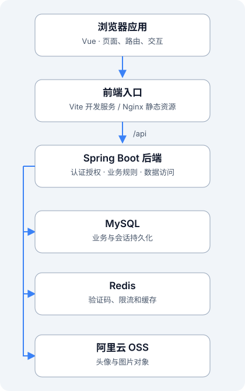
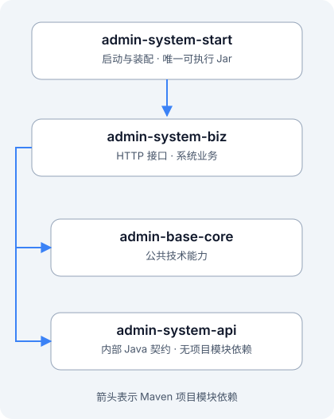

# 系统架构

Maple Hush Admin 采用前后端分离、后端模块化单体。浏览器运行 Vue 应用，通过 `/api` 访问 Spring Boot；MySQL、Redis 和 OSS 分别承担持久化数据、临时状态与对象存储职责。

## 系统协作



| 部分 | 职责 |
| --- | --- |
| 浏览器应用 | 页面渲染、表单交互、动态菜单、权限显示和会话协调 |
| 前端入口 | 提供静态资源，将同源 /api 请求代理到后端；源码开发时由 Vite 提供入口，容器运行时由前端 Nginx 提供 |
| Spring Boot | 参数校验、认证授权、业务事务、数据访问、审计和文件处理 |
| MySQL | 保存业务实体、授权关系、refresh 会话、日志与 Flyway 历史 |
| Redis | 保存验证码、限流计数、用户快照及有效权限缓存等；不承接业务主数据 |
| 阿里云 OSS | 保存头像和图片对象；由后端校验并上传，前端不持有 OSS AccessKey |

图中箭头表示主要请求或访问方向，不是容器网络拓扑或服务器安装步骤。文档站点本身独立构建为静态页面，预览文档不需要启动这些业务服务。

## 后端模块依赖



箭头表示 Maven 的项目模块依赖：`start → biz`，`biz → core`，`biz → api`。当前 `admin-system-api` 没有项目模块依赖，`admin-base-core` 不依赖业务模块。

| 模块 | 职责 | 不承担的职责 |
| --- | --- | --- |
| admin-base-core | 统一响应、异常、基础实体、Redis/MyBatis 公共配置、JWT 基础能力、OSS 技术能力 | 不实现用户和角色等具体业务 |
| admin-system-api | 当前用户、权限判断、部门查询等内部 Java 契约 | 不等同于 HTTP Controller，也不是独立 API 服务 |
| admin-system-biz | 认证、用户、角色、菜单、部门、字典、日志、文件接口与业务实现 | 不单独打包启动 |
| admin-system-start | 启动入口、环境装配、Flyway、运行文档配置与集成测试 | 不集中堆放业务实现 |

四个模块最终装配成 **一个可执行 Jar、一个 Spring Boot 进程**。模块拆分用于控制职责和依赖，不代表四个微服务。

## 一次业务请求

1. 页面调用应用 `src/api/` 中的请求方法。
2. 请求层附带 access token，处理统一响应和必要的会话刷新。
3. 后端认证过滤器识别当前用户，接口按所需权限码校验。
4. Controller 接收并校验 DTO，调用 Service 接口。
5. Service 实现业务规则与事务，通过 Mapper 访问数据。
6. 后端返回统一结果，前端提取业务 data 并更新页面。

```text
页面 → API 请求层 → 认证与授权 → Controller → Service 接口 / 实现 → Mapper → MySQL
```

普通业务响应使用 `code`、`data`、`error`、`message`，成功时 `code=0`；分页业务数据采用 `items`、`total`。HTTP 状态、业务错误码与显示消息有不同职责，详细接口规则将在开发规范中说明。

## 认证与授权职责

| 能力 | 实现方式 |
| --- | --- |
| 登录 | 用户名、密码和图形验证码校验；初始账号需要先完成强制改密 |
| 普通接口认证 | Authorization: Bearer access token；JWT 由后端签发并校验 |
| 刷新与退出 | refresh token 由 HttpOnly Cookie 承载；后端持久化哈希，轮换并检测重放 |
| CSRF 防护 | Cookie 相关的刷新、退出请求配合 CSRF token；具体范围由安全链实现 |
| 当前权限 | 后端计算角色和权限码，前端使用菜单/按钮权限控制显示，接口再次校验 |
| 多标签页会话 | 应用 auth 层协调刷新与失效，避免并发轮换互相覆盖 |

浏览器会话存储和多标签页协调属于前端实现；密码校验、权限判定与 refresh 会话安全规则由后端负责。JWT 不表示整个系统完全无状态，refresh 会话和授权数据仍有服务端记录。

## 数据与配置边界

- MySQL 结构由 `admin-system-start` 的 Flyway 迁移管理；新增版本向前迁移，不重复手工导入历史草案。
- `dev` 用于开发；`test`、`prod` 使用独立的凭据、JWT、Origin、数据库和对象存储配置。
- Knife4j / OpenAPI 只在开发和测试环境按配置开放，生产安全链拒绝文档入口。
- OSS 和 Redis 的连接、权限、配额等配置需要结合使用环境验证；后端不会因为页面隐藏了操作而跳过权限校验。

定位代码可继续阅读[目录结构](./directory.md)。
